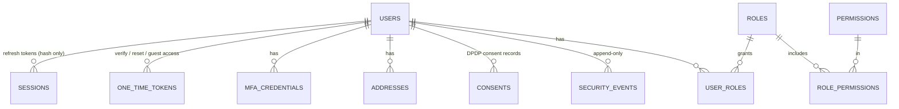
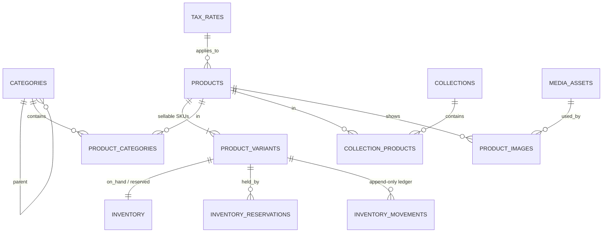
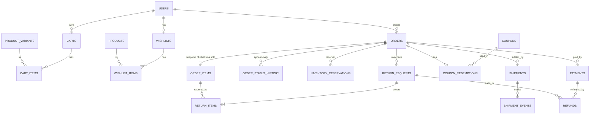
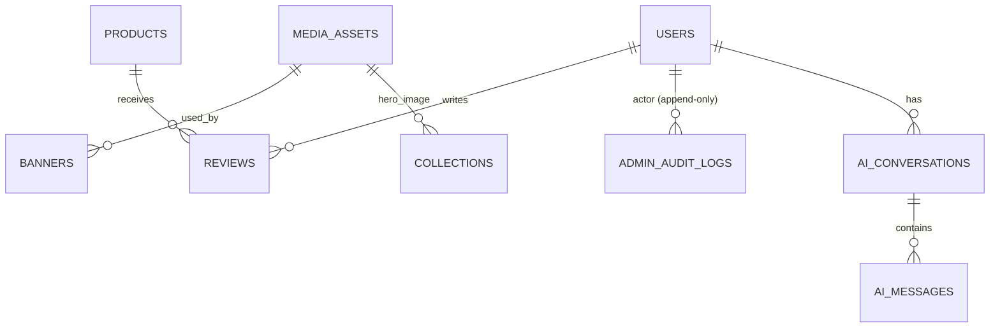

# Database ERD

Entity-relationship overview of the LLI database (PostgreSQL, `public` schema). Column-level detail is in [DATABASE_DICTIONARY.md](DATABASE_DICTIONARY.md), which is generated from the migrations. Source of truth: `backend/prisma/schema.prisma` plus `backend/prisma/migrations/0002_constraints`.

Design rules that apply everywhere: UUID keys, integer paise, `timestamptz`, foreign keys on every relation, soft deletes (`deleted_at`) only where history matters, and snapshots on orders so editing a product never changes a past order.

## Identity and access

## Catalogue and inventory

## Cart, wishlist and orders

`payment_webhook_events` stands alone (keyed by the gateway's unique event id) so duplicate deliveries are rejected before any order is touched.

## Content, audit and AI

Standalone tables: `cms_pages`, `site_settings`, `shipping_rates`, `idempotency_keys`, `notification_logs`, `payment_webhook_events`.

## Guarantees enforced by the database (not just the application)

| Guarantee | Mechanism |
|---|---|
| Stock never negative; `reserved <= on_hand` | `CHECK inventory_stock_chk` |
| Reservation is atomic | single `UPDATE … WHERE on_hand - reserved >= qty`; tested |
| One email per user, case-insensitive | unique `email_normalized` + check it is lower-case and trimmed |
| One default address, one active cart per user | partial unique indexes |
| One captured payment per order | partial unique index |
| Gateway events/payments processed once | unique `provider_event_id`, `provider_payment_id`, `provider_order_id` |
| Audit, security, stock-ledger and status-history rows cannot be changed | triggers reject `UPDATE`/`DELETE`/`TRUNCATE`; app role also lacks the privileges |
| Orders only move along legal edges | trigger `orders_status_transition` (mirrors SYSTEM_ARCHITECTURE §6.2) |
| Money is non-negative integers; currency is INR | `CHECK`s on orders, items, payments, refunds, coupons, variants |
| Ratings 1–5; one review per user per product | `CHECK` + unique |

## Known limits and open questions

- **GST:** whether listed prices include GST is undecided (roadmap D14), so `orders.total_paise` is not yet tied to a formula. Tax rates are seeded inactive.
- **Rejected returns:** the state machine has no edge from `RETURN_REQUESTED` back to `DELIVERED`, so a rejected return cannot restore the order status. Needs a product decision before Phase 5. `PARTIALLY_REFUNDED → REFUNDED` was added beyond the original diagram.
- **User deletion:** users are never hard-deleted. Erasure (DPDP) is anonymisation by the service, because the append-only triggers also block the foreign-key `SET NULL` that a hard delete would cause.
- **Search:** `products.search_vector` (generated `tsvector`) and `pg_trgm` indexes cover name, tagline, type, material and SKU. Variant attributes are not searchable yet.
- **Prisma drift:** the generated column, triggers and CHECKs are invisible to Prisma. Use `prisma migrate deploy` only; never `migrate dev` or `db push`.
