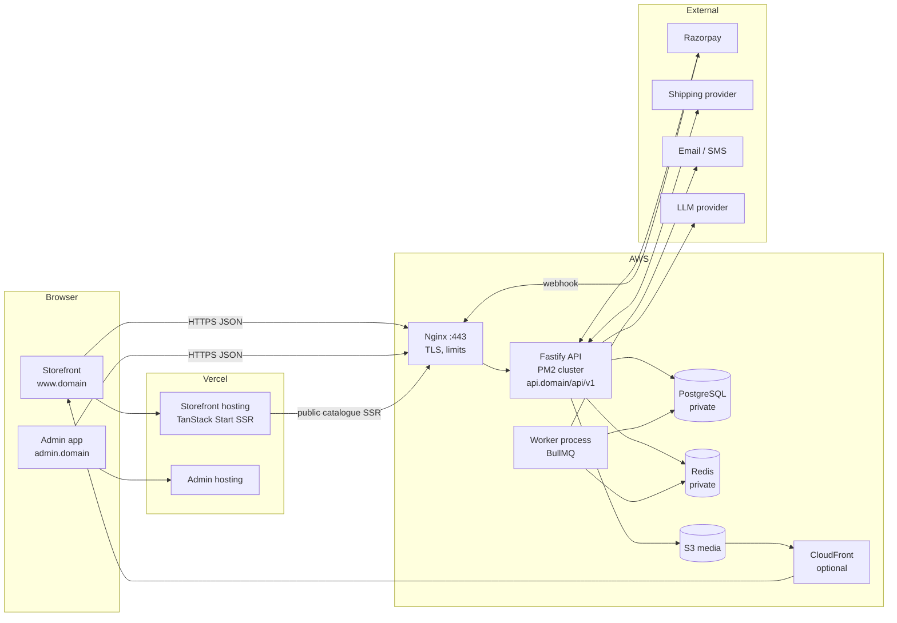
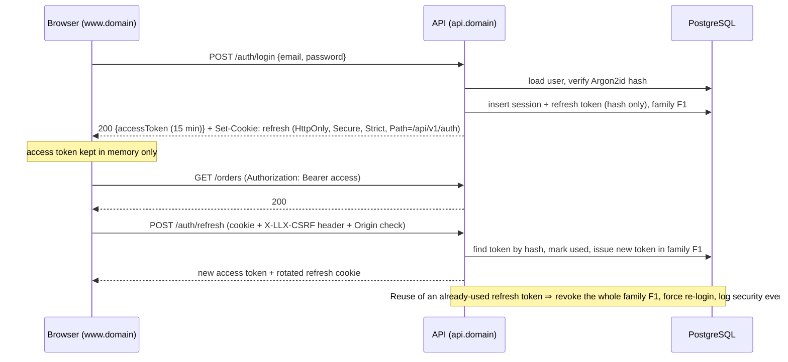
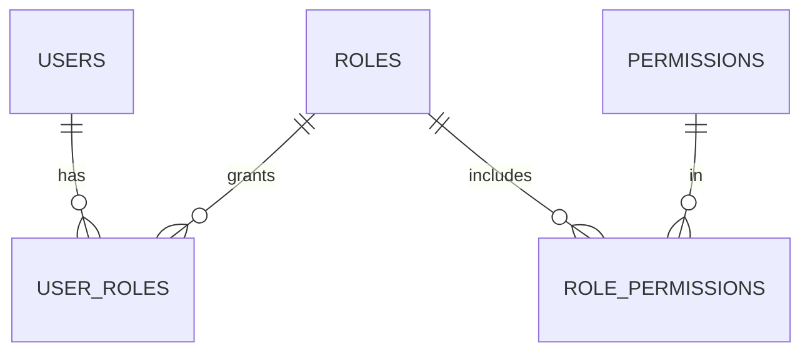
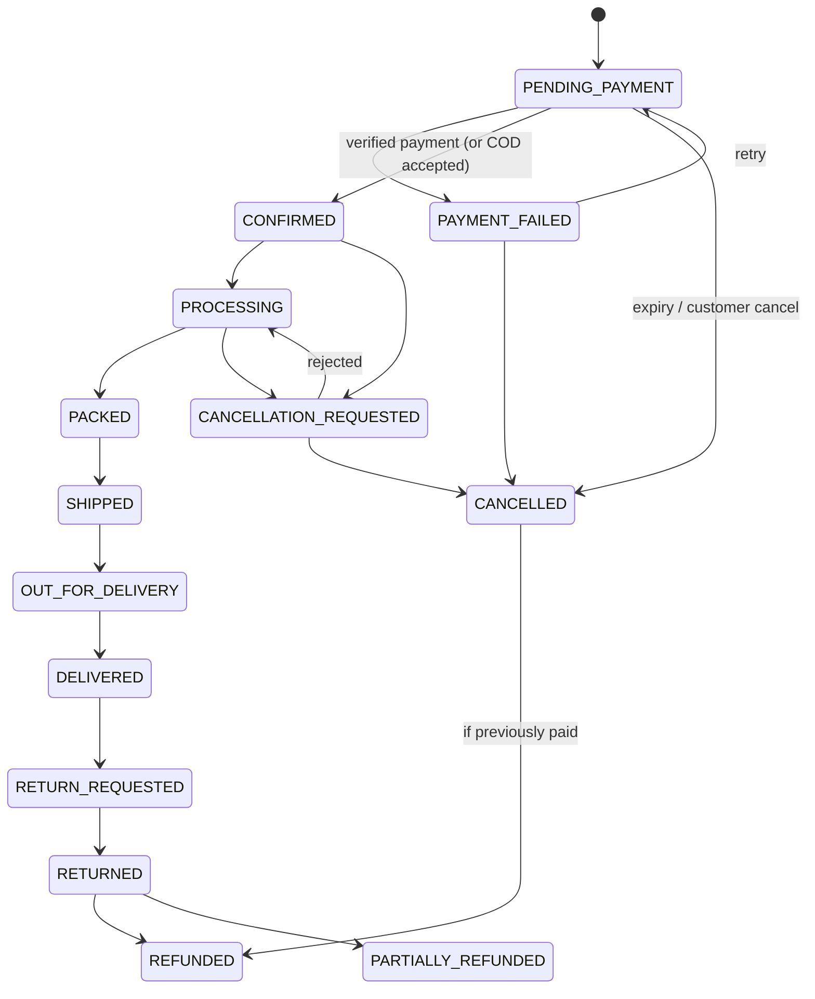
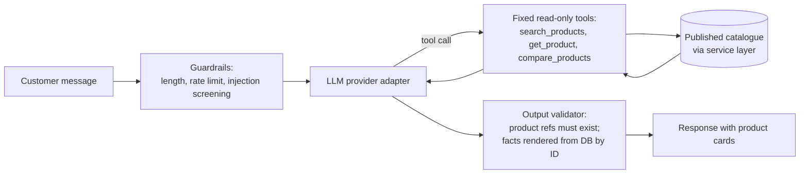
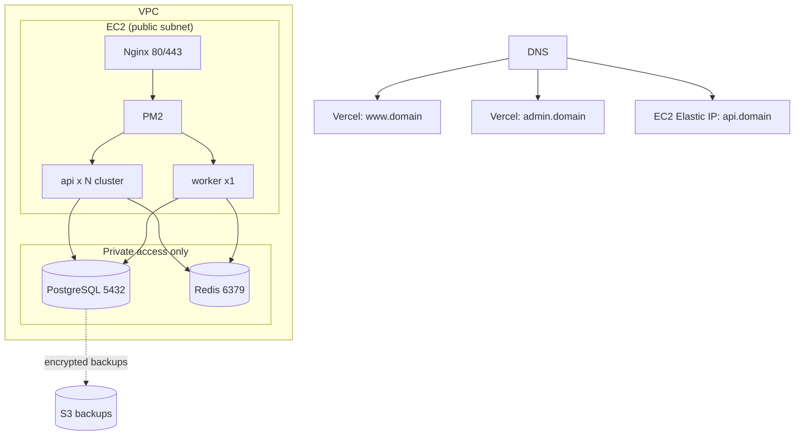

# System Architecture — Leather Lux India

| | |
|---|---|
| Status | Proposed — requires approval of the open decisions in `IMPLEMENTATION_ROADMAP.md` §3 |
| Style | **Modular monolith** (one deployable backend), separate storefront and admin frontends |
| Rule | Nothing here changes the approved storefront design |

Diagrams use Mermaid (renders on GitHub and in most Markdown viewers).

---

## 1. System context



**Hard rules**

- The browser never talks to PostgreSQL, Redis or S3 write APIs directly. (S3 uploads use short-lived, condition-bound pre-signed requests issued by the API.)
- PostgreSQL (5432) and Redis (6379) accept connections only from the API/worker hosts via security groups.
- Secrets exist only in the server environment; the frontend receives public identifiers only (API base URL, Razorpay *key id*).

---

## 2. Frontend architecture

### 2.1 Storefront (existing app)

- Keep TanStack Start, routes, components and design tokens.
- Add an **API client layer** (`src/lib/api/`): typed fetch wrapper, error mapping, request-ID propagation, access token held **in memory**.
- Server state through `@tanstack/react-query` (already installed): catalogue, cart, wishlist, orders, account.
- `store.tsx` is reduced to UI-only state (open panel). Cart and wishlist become server-backed hooks; the optimistic UI stays so the design behaves identically.
- Rendering policy:

| Content | Rendering |
|---|---|
| Home, collections, product detail | SSR with data from the public catalogue API (cacheable) |
| Cart, wishlist, account, orders, checkout | Client-side after hydration (auth cookie lives on the API origin; see §4) |

- Loading, empty and error states reuse existing skeleton/typography; no visual redesign.

### 2.2 Admin application (new)

A separate Vite + React app on `admin.<domain>`, its own Vercel project. Reasons: smaller customer bundle, stricter CSP, independent deployment, MFA-gated sessions, no admin code or routes shipped to shoppers. Uses the same API with admin-scoped endpoints and permissions.

---

## 3. Backend architecture

### 3.1 Layering

```
HTTP route (Fastify)        thin: auth hook → schema validation → call service
  └─ Controller/handler     maps request → service input, service output → response
      └─ Service            business rules, transactions, authorization policy checks
          └─ Repository     Prisma queries; the only layer that touches the DB
              └─ PostgreSQL
Cross-cutting: config, logger, errors, rate limiting, audit, idempotency
Integrations (adapters): payments, shipping, storage, email, sms, ai
```

- Modules follow the structure in the brief (`auth`, `products`, `inventory`, `cart`, `checkout`, `orders`, `payments`, …). Modules call each other only through exported service interfaces — never another module's repository.
- Fastify as the default; Prisma for access and migrations; Zod (v4) for request/response/config validation; Pino for logs.
- `app.ts` builds the Fastify instance (testable without listening); `server.ts` starts it; `worker.ts` starts BullMQ consumers as a **separate PM2 process** from the same codebase.

### 3.2 API conventions

- Base path `/api/v1`. OpenAPI generated from the Zod schemas; Swagger UI only in development or behind admin auth.
- Success: `{ "data": …, "meta": { "requestId", "page"? } }`. Failure: `{ "error": { "code", "message", "details"?, "requestId" } }`. Stable machine-readable `code` values.
- Pagination: cursor-based for public lists (stable under writes), offset for admin tables. Sort and filter fields are **whitelists** per endpoint.
- Mutations that must not repeat (checkout, payment create, refund) require an `Idempotency-Key` header; keys are stored with a request hash and the cached response.
- Money is **integer paise** everywhere (`Int` for line values, `BigInt` for report aggregates). No floating-point arithmetic on money; percentages use integer basis points with explicit rounding rules.

---

## 4. Authentication and token lifecycle



| Aspect | Decision |
|---|---|
| Password hashing | Argon2id, parameters benchmarked on the actual EC2 size (target ≈ 250–500 ms) and stored with the hash for future re-hash |
| Access token | Signed JWT (asymmetric, `kid` header for rotation), 15 min, claims: `sub`, `sid`, `roles-version`; **no permissions in the token** — permissions are resolved server-side from the DB/Redis cache so revocation is immediate |
| Refresh token | 256-bit random, stored as SHA-256 hash, rotated on every use, family tracking, absolute lifetime (e.g. 30 days customers, 8 h admins), idle timeout |
| Cookie | `__Secure-` prefix, host-only (no `Domain`), `Path=/api/v1/auth`, `HttpOnly`, `Secure`, `SameSite=Strict`; refresh endpoint additionally requires a custom header and a strict `Origin` allowlist |
| CORS | Explicit origin allowlist, `credentials: true`, never `*` |
| Never | Tokens in `localStorage`/`sessionStorage`, tokens in URLs, tokens in logs |
| Admin | TOTP (RFC 6238) or WebAuthn mandatory; step-up re-authentication for refunds, role changes, settings |
| Guest checkout (if approved) | Order access via an unguessable, single-purpose, expiring signed token emailed to the buyer; no standing session |

**Same-site arrangement:** `www.<domain>` and `api.<domain>` share a registrable domain, so `SameSite=Strict` cookies flow for XHR from the storefront. Vercel preview URLs (`*.vercel.app`) do not; authenticated testing uses the staging subdomain pair (Audit C3).

---

## 5. Authorization (RBAC)



- Permissions are strings (`products.update`, `refunds.approve`, `roles.manage`, …). Routes declare the permission they need; a single `requirePermission()` hook enforces it — **deny by default**: a route without an explicit policy fails a startup check.
- Resolved permission sets are cached in Redis per user with a version counter; role changes bump the version, invalidating immediately.
- **Ownership checks** live in services, not routes: every customer-facing read/write scopes by `userId` (or guest token) in the *query itself* (`WHERE id = $1 AND user_id = $2`), so a guessed ID returns 404, never another customer's data (BOLA/IDOR).
- Sensitive fields (cost price, full phone/address for non-support roles) are stripped by response mappers keyed on permission.
- Role-assignment is itself guarded: nobody can grant a permission they do not hold; `Super Admin` is the only holder of `roles.manage`.
- Every privileged mutation writes `admin_audit_logs` **in the same transaction**.

---

## 6. Data architecture (PostgreSQL)

Detailed schema is produced in Phase 1 (`DATABASE_ERD.md`, `DATABASE_DICTIONARY.md`). Design principles:

- UUID primary keys (UUIDv7 where available, for index locality); `created_at`/`updated_at` as `timestamptz` (UTC).
- Foreign keys everywhere; `CHECK` constraints for invariants (non-negative stock, `reserved <= on_hand`, valid status values, price ≥ 0); partial unique indexes for soft-deleted rows.
- **Snapshots:** `order_items` copy name, SKU, variant attributes, unit price, tax, discount. Editing a product never alters history.
- **Audit and security tables** are append-only: the application role has `INSERT`/`SELECT` only on `admin_audit_logs`; a trigger rejects `UPDATE`/`DELETE`.
- **Roles (DB users):** `llx_migrator` (DDL, used only by the migration step), `llx_app` (DML on application tables), `llx_readonly` (reporting). The PostgreSQL superuser is never used by the application.
- **Connections:** pooled; `statement_timeout` and `idle_in_transaction_session_timeout` set; TLS required when the database is not on the same host.
- **Search:** `tsvector` generated column + `pg_trgm` index on product name/SKU/tags. Revisit only if measured latency demands it.

### 6.1 Inventory concurrency

Stock is never read-then-written. Reservation is a single atomic statement inside the checkout transaction:

```sql
UPDATE inventory
   SET reserved = reserved + $qty
 WHERE variant_id = $variant
   AND (on_hand - reserved) >= $qty;   -- 0 rows affected ⇒ insufficient stock
```

backed by `CHECK (on_hand >= 0 AND reserved >= 0 AND reserved <= on_hand)`. A row in `inventory_reservations` (with `expires_at`, default 15 min) records the hold. Payment success converts the reservation into a decrement of `on_hand` and `reserved` plus an `inventory_movements` row; payment failure or expiry releases it. A scheduled job sweeps expired reservations; release is idempotent.

### 6.2 Order state machine (enforced in the service)



Every transition is a function `transition(order, to, actor, reason)` that validates the edge, writes `order_status_history`, and emits a domain event; no code updates `orders.status` directly.

---

## 7. Checkout and payment flow

```mermaid
sequenceDiagram
  participant B as Browser
  participant A as API
  participant D as PostgreSQL
  participant R as Razorpay

  B->>A: POST /checkout/quote {cart, address, coupon}
  A->>D: price from DB, tax, shipping, coupon (server-side only)
  A-->>B: quote (amounts in paise, expires)

  B->>A: POST /checkout {quoteId} + Idempotency-Key
  A->>D: BEGIN; recompute; reserve stock; create order PENDING_PAYMENT; snapshot lines; COMMIT
  A->>R: create order (amount from DB)
  A-->>B: {orderId, razorpayOrderId, keyId}   (public values only)

  B->>R: customer pays in Razorpay Checkout
  R-->>B: {order_id, payment_id, signature}
  B->>A: POST /payments/verify
  A->>A: HMAC-SHA256 verify (constant-time) — advisory only
  A->>R: fetch payment, confirm status + amount + currency

  R-->>A: POST /payments/webhooks/razorpay (raw body)
  A->>A: verify webhook signature over RAW body
  A->>D: insert payment_webhook_events (provider event id UNIQUE) — duplicate ⇒ 200, no-op
  A->>D: BEGIN; mark paid; confirm stock; CONFIRMED; enqueue notifications; COMMIT
```

Rules (from the brief, made concrete):

1. The **browser's success message never marks an order paid.** Only a verified webhook or a server-side fetch from the gateway can.
2. Amount and currency from the gateway must equal the order's stored amount, or the order is flagged for review.
3. The webhook route is registered with a raw-body parser; it is exempt from CSRF but protected by signature, event-ID dedupe and (optionally) the provider's IP allowlist.
4. A reconciliation job periodically fetches `created`/`attempted` Razorpay orders older than N minutes and settles them, covering lost webhooks.
5. Refunds: a service method requiring `refunds.approve`, an `Idempotency-Key`, and an audit row; partial refunds sum-checked against captured minus refunded.
6. All provider access sits behind a `PaymentProvider` interface (`createOrder`, `verifySignature`, `fetchPayment`, `refund`, `parseWebhook`) so another gateway can be added without touching orders or inventory.

---

## 8. Redis and background jobs

| Use | Notes |
|---|---|
| Rate limiting | Sliding-window counters, key-prefixed `rl:` |
| Public catalogue cache | `cache:` prefix with TTL; invalidated by product/collection/CMS publish events |
| Permission cache | `perm:{userId}:{version}` |
| Queues (BullMQ) | `notifications`, `payments-reconcile`, `inventory-sweeper`, `shipping-sync`, `ai-summaries`, `reports`, `media-process` |

**Operational constraint:** BullMQ requires Redis `maxmemory-policy noeviction`, whereas a cache wants eviction. Use **two Redis logical deployments** (separate instances, or at minimum separate processes/ports) — one `noeviction` for queues, one `allkeys-lru` for cache and rate limits. Jobs are idempotent (natural keys / dedupe IDs), retried with exponential backoff, and failures go to a dead-letter queue with an alert. Redis is never the system of record.

---

## 9. Media pipeline

1. Admin requests an upload; API checks permission and returns a **pre-signed POST** to a *quarantine* prefix with conditions (content-type allowlist, max size, key prefix).
2. Browser uploads directly to S3.
3. `media-process` job: verify magic bytes, decode and **re-encode** with an image library (strips EXIF and neutralises polyglots), reject on failure, generate responsive sizes/WebP/AVIF, write to the *public* prefix with a random filename, store metadata (`media_assets`) in PostgreSQL.
4. Public delivery through CloudFront with Origin Access Control (S3 bucket stays private) when enabled; otherwise S3 with public-read limited to the public prefix.

Review images (if enabled) use the same pipeline with stricter limits and moderation.

---

## 10. CMS and storefront configuration

- Content is stored as **schema-validated blocks** (Zod discriminated union: `hero`, `collectionGrid`, `productCarousel`, `banner`, `richText`, …). Rich text is a restricted JSON document model rendered by React components — **no raw HTML, no scripts**, and URLs restricted to `https`/relative.
- Each page/section has `draft` and `published` versions with preview tokens; publishing is a permissioned, audited action that busts the relevant Redis cache keys.
- Design tokens remain in code; admin may select from an approved palette/typography set only if you decide to expose it.

---

## 11. AI shopping assistant



- The model **cannot** run SQL and has no tool for orders, payments, customers or admin data. Tools accept Zod-validated parameters and return only published-product fields.
- Prices, availability, dimensions and discounts shown to the customer are taken from the database by product ID — the model's prose cannot assert them.
- Untrusted text (user input, product descriptions) is delimited in the prompt and treated as data; the system prompt is server-side, admin-editable only through an audited, versioned setting.
- Per-user and global rate/cost limits, hard timeouts, circuit breaker, and a no-AI fallback (normal search results).
- Tables: `ai_conversations`, `ai_messages`, `ai_conversation_summaries`, `ai_usage_logs`; retention default 90 days (for approval); user can clear a conversation.
- No live calls until a provider key is configured.

---

## 12. Deployment architecture



- Security group: 80/443 from the internet to Nginx; SSH only from your fixed IP/SSM Session Manager; 5432 and 6379 from the app security group only (or localhost if co-located).
- Process model: PM2 `api` (cluster mode, N = vCPUs − 1) and `worker` (fork, 1 instance); non-root user; `max_memory_restart`; log rotation; `pm2 startup` + `pm2 save`; graceful shutdown on `SIGTERM`.
- Nginx: TLS (Let's Encrypt or ACM-terminated alternative), modern TLS only, request-size and timeout limits, `X-Forwarded-*` set, `limit_req` as a first rate-limit layer, upstream health check against `/ready`.
- Environments: `development` (local), `staging` (own subdomain pair, own DB/Redis/S3/Razorpay test keys), `production`. Separate secrets per environment.
- Deploys: GitHub Actions builds artefacts; production deploy is a manually approved workflow; **migrations run as a separate, explicit step** under an advisory lock, never on app start.
- `/health` (liveness, no dependencies) and `/ready` (PostgreSQL + Redis checks) used by Nginx, PM2 scripts and monitors.

If PostgreSQL turns out to live on the same EC2 host, the topology is the same with `localhost` bindings; the roadmap includes a cost/operations comparison against managed PostgreSQL (not a migration).

---

## 13. Observability and recovery

- Pino JSON logs with request/correlation ID, route, status, duration, user ID (not email); redaction list for tokens, passwords, card-like patterns, `authorization`, cookies.
- Error monitoring and metrics through pluggable adapters (Sentry-compatible, Prometheus-style endpoint on an internal port).
- Backups: nightly base backup + continuous WAL archiving to encrypted S3 for point-in-time recovery; retention and **restore tests** documented and scheduled. Proposed targets for approval: **RPO ≤ 15 minutes, RTO ≤ 4 hours**.

---

## 14. Technology decisions (summary)

| Concern | Choice | Alternative considered | Why |
|---|---|---|---|
| API framework | Fastify + TypeScript | Express, NestJS | Fast, schema-first, mature plugin ecosystem; NestJS adds weight not justified for a modular monolith |
| ORM | Prisma + reviewed SQL migrations | Drizzle, Kysely | Named default in the brief; raw SQL used where Prisma cannot express constraints (CHECKs, triggers, partial indexes) |
| Validation | Zod 4 | Valibot, TypeBox | Shared with frontend; drives OpenAPI |
| Jobs | BullMQ | pg-boss | Redis already required; mature retries/dead-letter |
| Passwords | Argon2id (`argon2`) | bcrypt | Brief requirement |
| Hosting | Vercel + EC2 + Nginx + PM2 | Serverless API | Brief requirement |
| Search | PostgreSQL FTS + trigram | OpenSearch | Brief: measure first |
| Microservices | **No** | | Brief: not without measured need |
